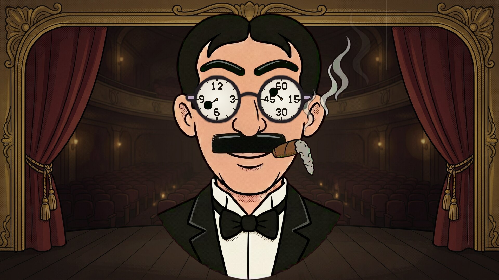
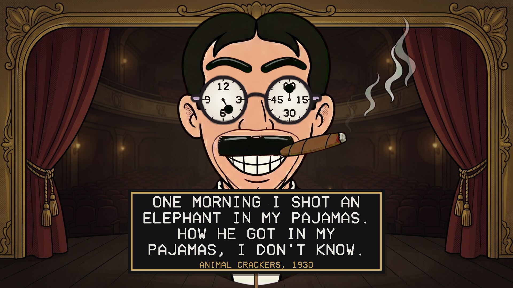
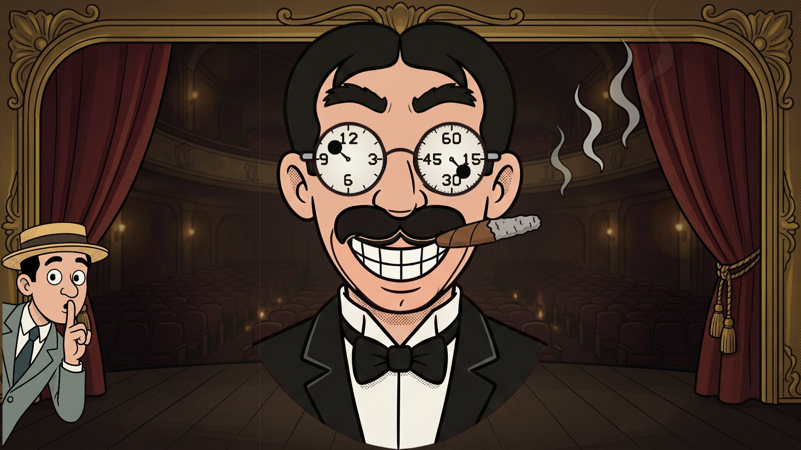
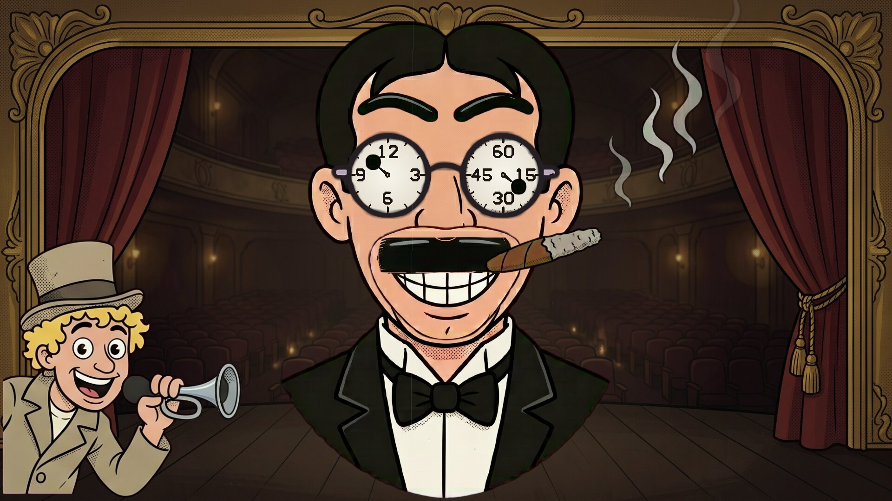
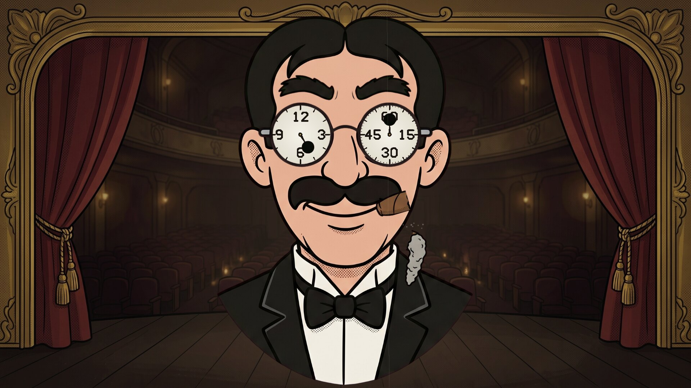

# The Groucho Clock

A cartoon screensaver clock: Groucho Marx tells the time with his eyes. Runs on
Linux, Windows and macOS. One of the
[Marx Brothers screensavers](https://github.com/mottipython/marx-screensavers).

## What it shows

Groucho, head and shoulders on a theatre stage, in his painted greasepaint moustache
and eyebrows.

- **The time, in his glasses.** Each lens is a clock face: hours on the left (12, 3,
  6, 9) and minutes on the right (60, 15, 30, 45, with a tick for every minute). His
  pupils are at the tips of the hands.
- **The seconds** tick on his cigar, which snaps up and down a notch every second.
- **Every minute** his eyebrows waggle.
- **Through the hour** the cigar burns down and the ash grows. On the hour he taps
  it, the ash breaks off and falls, and he lights a new one and grins.
- **Every quarter of an hour** one of his own lines comes up on a card, with the film
  it is from: 51 of them, from *The Cocoanuts* to *A Day at the Races*, in a different
  order every day.
- **Now and then** one of his brothers peeks in from the left: Gummo (who left the act
  before the films) raises his boater, winks or shushes; Chico tips his hat, winks or
  has an idea; Harpo honks his horn, pulls his "gookie" face or waves; Zeppo raises an
  eyebrow, smiles or shrugs. Groucho's eyebrows go up for each, and he grins.
- **The sound** is a clock's: a quiet tick-tock, a chime with each line, and on the
  hour the cigar tapped, the ash falling and a match struck. Harpo's horn is a real
  one. The sound can be turned off (below).

| | |
|---|---|
|  |  |
| Five o'clock | Gummo |
|  |  |
| Harpo | The ash falling |

## Install

Packages are on the [releases page](../../releases).

### Windows

For Windows 10 or 11, step by step:

1. [**Download The Groucho Clock**](https://github.com/mottipython/groucho-clock/releases/latest/download/GrouchoClock-Setup-1.1.1.exe).
2. If the browser says the file "isn't commonly downloaded" or "could harm your
   device", click the **⋯** (or **^**) beside it and choose **Keep**, then **Keep
   anyway**.
3. Open the downloaded file (click it at the top or bottom of the browser, or find
   it in the **Downloads** folder).
4. A blue box may say **"Windows protected your PC"**. Click **More info**, then
   **Run anyway**. (It says this because the program isn't signed with a paid
   certificate, not because anything is wrong with it.)
5. Windows asks **"Do you want to allow this app to make changes?"** Click **Yes**.
   (Windows only lists screen savers kept in its own system folder.)
6. Click **Next**, then **Install**, then **Finish**. The Screen Saver Settings open
   with "The Groucho Clock" already chosen. Click **OK**.

It comes on by itself when the computer has been left alone. To pick a different
one later, type **screen saver** in the Start menu search and open **Change screen
saver**. To remove it, open **Settings**, **Apps**, find it in the list and choose
**Uninstall**.

### macOS

For Apple Silicon and Intel, macOS 11 or later. Paste this into Terminal; it installs
the screen saver for your user and opens the Screen Saver settings:

    curl -fsSL https://raw.githubusercontent.com/mottipython/marx-screensavers/main/tools/mac-install.sh | sh -s -- groucho-clock

Or download the file ending `-mac-screensaver.zip` from the releases page, unzip it
and double-click the `.saver` file. It is not signed with an Apple developer
certificate, so macOS will refuse it at first: open System Settings, Privacy &
Security, and click Open Anyway.

### Linux

**Fedora, Nobara** (built on Fedora 44):

    sudo dnf install ./groucho-clock-1.1.1-1.fc44.x86_64.rpm

**Debian, Ubuntu, Mint** (Ubuntu 24.04 / Debian 13 or later):

    sudo apt install ./groucho-clock_1.1.1_amd64.deb

From your next login it starts by itself after five minutes idle on Wayland desktops
that provide ext-idle-notify (KDE Plasma, Sway, Hyprland, niri, COSMIC, labwc and
others), and any key or mouse movement ends it. `groucho-clock-screensaver` changes the
delay or turns it off. If
[screensaver-service](https://github.com/mottipython/screensaver-service) is
installed, it appears in its list instead.

## Sound on or off

The sound can be turned off and on from the screen saver settings: on Windows, the
**Settings…** button in Screen Saver Settings; on Linux, the **Settings** button in
[screensaver-service](https://github.com/mottipython/screensaver-service)'s list, or
`groucho-clock --settings`.

## Running it yourself

    groucho-clock                  full screen on every display
    groucho-clock --window         in a window; Esc or Q quits
    groucho-clock --mute           without the sound
    groucho-clock --clock 4:59:50  start at that time of day instead of the real time
    groucho-clock --snapshot out.bmp --time 3 --size 1920x1080

## How it was made

The cartoon pictures were drawn with Google's Gemini from the prompts in
`assets/PROMPTS.md` (the sheets as Gemini made them are in `assets/src`), then cut up
by `tools/make_parts.py` and put together and animated in code. The program was
written with Anthropic's Claude, working from the author's direction. The lines are
Groucho's own, as Wikiquote gives them. The sounds are made in code, except Harpo's
horn, which is a recording from public-domain media.

## Building

Needs a C compiler, make and SDL2 (2.0.18 or newer). Build from the top of the source
tree, because the pictures in `assets/art` are built into the program.

    make

Packages are written to `dist/`, using the container in `tools/Containerfile`:

    podman build -t anathem-build -f tools/Containerfile tools
    podman run --rm --security-opt label=disable -v "$PWD":/src -w /src anathem-build make dist

## Credits and licence

The code is MIT. An unofficial, non-commercial homage, not connected with the Marx
Brothers' estate or the studios. Images are decoded with
[stb_image](https://github.com/nothings/stb) (public domain).
